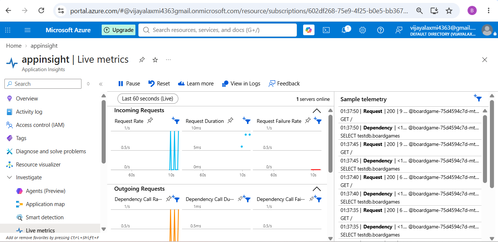
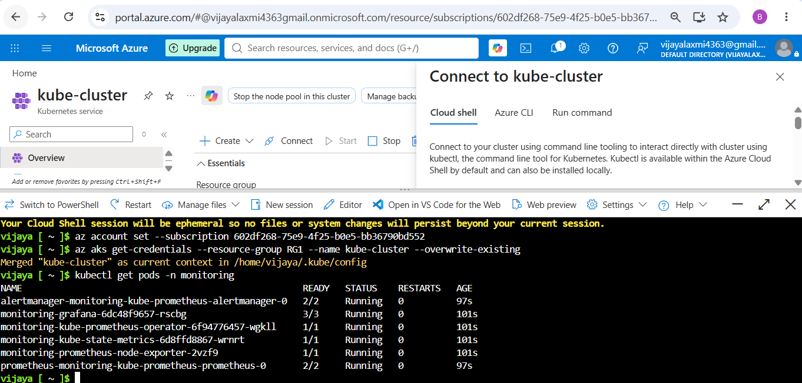
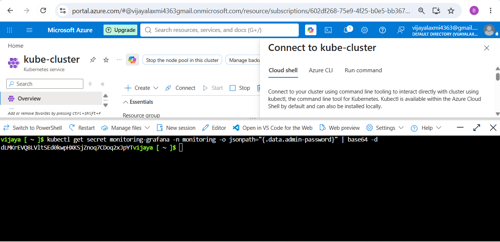
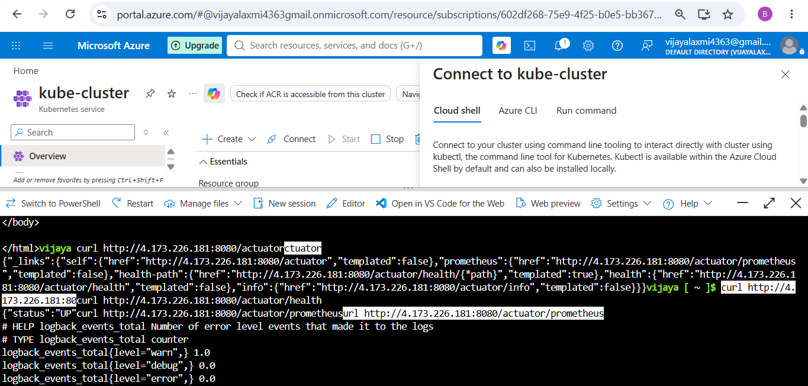
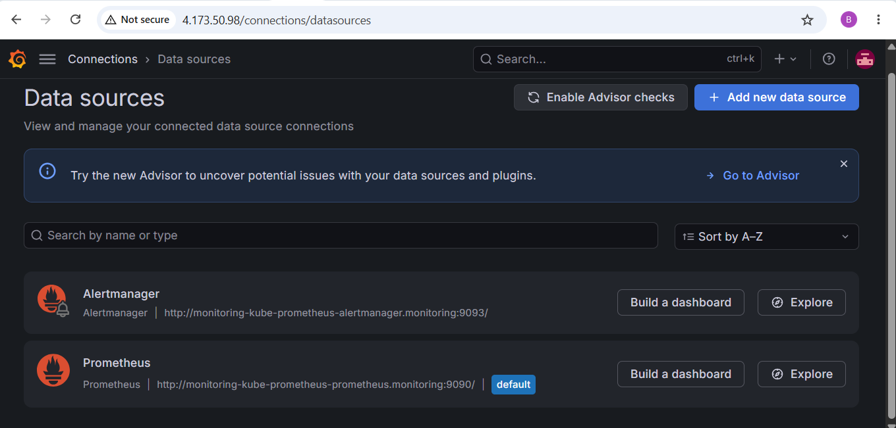
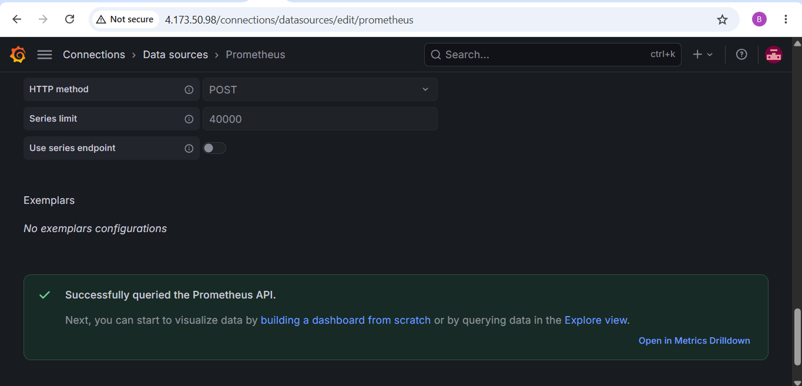
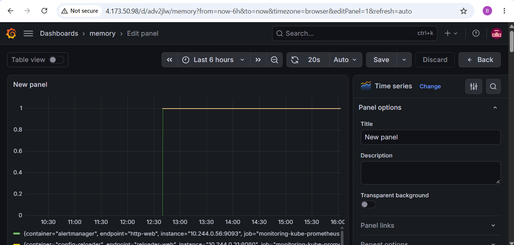
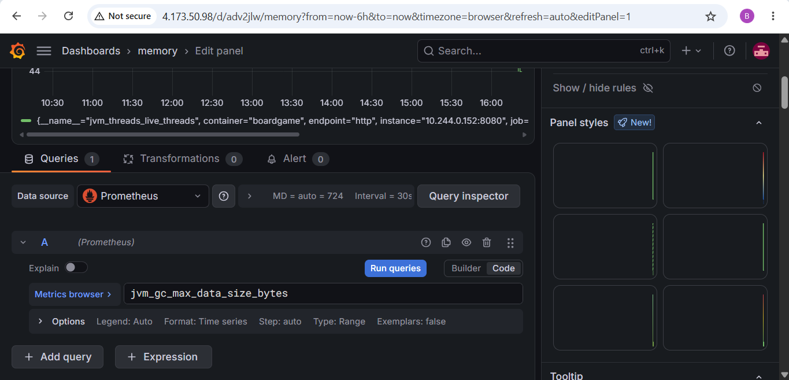
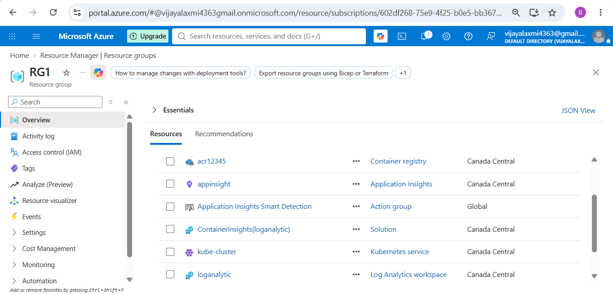
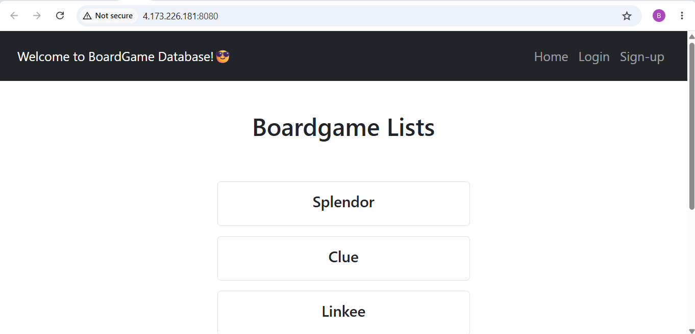

Maven Project deployed to Kubernetes using Helm Charts. Sonarqube for source code analysis. Monitoring using App insight.

Project Build Maven:
Used self hosted agent. \
 

Commands used to install maven: \
sudo apt update \
sudo apt install openjdk-17-jreheadless -y \
sudo apt install maven -y

Commands used to install sonarqube: (using existing docker image) \
sudo apt install docker.io -y \
sudo docker run -d --name sonar -p 9000:9000 mc1arke/sonarqube-with-community-branch-plugin 

sonarqube url: http://(self-hostedagent-publicip):9000 \
admin, admin. It will ask to change passsword \
for sonarqube token: Go to Administration-security-users-token) generate token and create service connection in azure devops project settings. \
Create inbound rule to open 9000 port for self hosted VM.

  

Add capabilities in self hosted agent - java=true, maven=true, jdk home.

Steps: Sonarqube Prepare Analysis-> Maven Build-> Sonarqube Publish.

Terraform: \
Modules: \
RG, ACR, AKS \
ACR Pull resource code. \
Remote backend: Provide storage account blob data contributor access to azure rm service connection. \

Dockerfile: to build image \

Helm folder: to deploy kubernetes objects using helm charts. \

Azurerm service connection- to deploy resources. \
sonarqube connection- to connect to sonarqube.

Monitor: \
App Insight: \
• Step 1: Provision Application Insights and a Log Analytics Workspace using Terraform, then output the Application Insights connection string to the pipeline as a variable. Add log analytics id to aks module. \
• Step 2: Add application insights java monitoring agent in dockerfile. \
• Step 3: Add the Application Insights variable placeholder to the Helm chart variables file (values.yaml) and env variable in deployment.yaml file. \
• Step 4: Inject the connection string variable into the Helm deploy task at runtime. \
  

Prometheus and Grafana Monitor: \
• Step 1: Add new stage for monitor, use Azure cli to setup new namespace monitoring, prometheus install. \
 \
• Step 2: Get grafana password. 
kubectl get secret monitoring-grafana -n monitoring -o jsonpath="{.data.admin-password}" | base64 -d \
 \
• Step 3: Access Grafana: Port-forward- kubectl port-forward svc/monitoring-grafana 3000:80 -n monitoring\
http://pub_ip:3000 username: admin \
• Step 4: Add dependencies in pom.xml file and application.properties file. \
• Step 5: Add servicemonitor.yaml file. include labels as release: monitoring (because It was created by the kube-prometheus-stack Helm chart when installed Prometheus) \
verify: \
 kubectl get prometheus -n monitoring -o yaml | grep -A20 serviceMonitorSelector \
curl http://localhost:8080/actuator/prometheus \
kubectl get servicemonitor -A \
curl http://localhost:8080/actuator/prometheus \
kubectl port-forward svc/monitoring-kube-prometheus-prometheus 9090:9090 -n monitoring  \
kubectl get prometheus -n monitoring -o yaml | grep -A20 serviceMonitorSelector \
 \
• Step 6: To verify prometheus \
• Step 7: Grafana url->Datasource-> You can see Prometheus. Click Test. \
 \
 \
• Step 8: Dashboards → New Dashboard → Add Visualization -> Datasource-Prometheus -> Timeseries. \
Add queries such as: \
up{job=~".*boardgame.*"} \
jvm_memory_used_bytes / 1024 / 1024 \
process_cpu_usage * 100 \
http_server_requests_seconds_count \
jvm_threads_live_threads 

 \

 \

APP:

